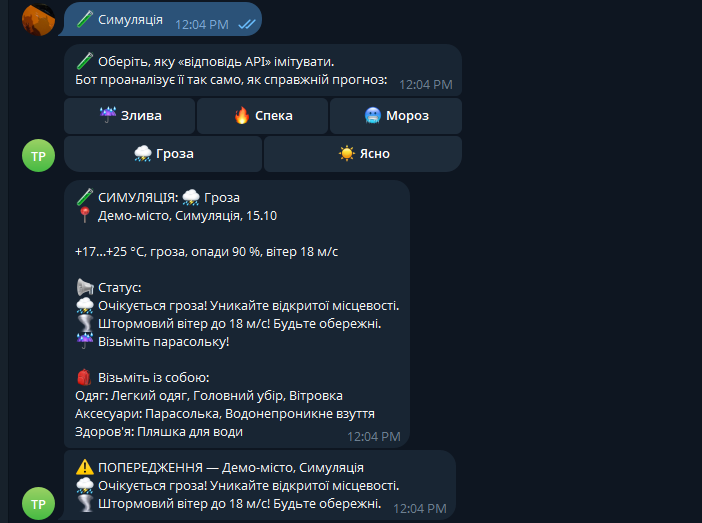
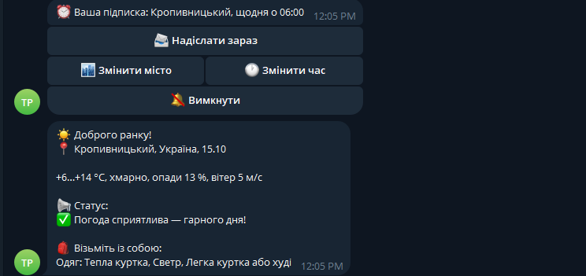
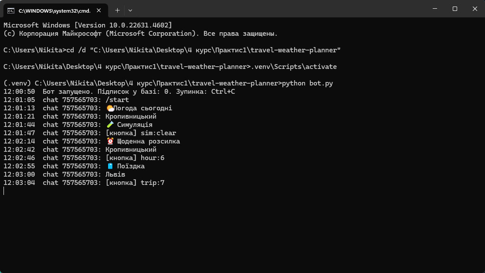
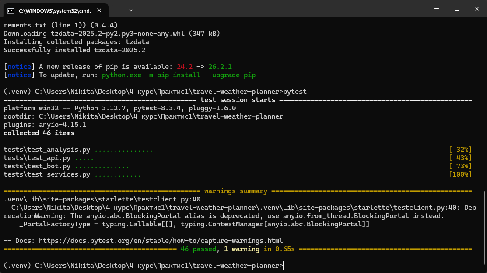

# 🧳 Travel Weather Planner - розумний помічник мандрівника

Telegram-бот, який аналізує прогноз погоди й підказує, що взяти з собою:
- **на запит** - погода на сьогодні або план поїздки з чек-листом речей;
- **за розкладом** - щоранку в обраний час надсилає прогноз, а вдень попереджає про небезпечну погоду (гроза, штормовий вітер, мороз, спека).

**Telegram-бот:** [@trip_weather_helper_bot](https://t.me/trip_weather_helper_bot) · **Вебсайт:** _посилання з'явиться після розгортання_

## 📐 Архітектура системи


1. **Користувач** працює з ботом у Telegram або з вебсторінкою.
2. **Протоколи:** HTTPS REST (JSON); Telegram надсилає повідомлення на **webhook** сервера (HTTPS POST із секретним заголовком).
3. **Бекенд** (FastAPI у Docker-контейнері на Render) запитує в **API 1 (Open-Meteo)** координати міста й прогноз, **аналізує** дані (валідація, статуси-попередження), формує чек-ліст і відповідає через **API 2 (Telegram Bot API)**.
4. **Планувальник:** GitHub Actions кожні 10 хв викликає `/api/v1/tick` - сервер розсилає ранкові прогнози й перевіряє небезпечну погоду.
5. **Дані:** підписки - у PostgreSQL (Render), прогнози кешуються в пам'яті на 30 хв.

Детальний аналіз предметної області: [`docs/day1-analysis.md`](docs/day1-analysis.md) · Схема API: [`docs/api.md`](docs/api.md)

## 🛠 Технологічний стек

- **Мова:** Python 3.12
- **Фреймворк:** FastAPI + Uvicorn, httpx (HTTP-клієнт)
- **База даних:** PostgreSQL (хмара), SQLite (локально)
- **Frontend:** HTML, CSS, JavaScript
- **Розгортання:** Docker, Render.com (Web Service), GitHub Actions (планувальник)

**Інтегровані API:**

| API | Призначення | Ключ | Документація |
|---|---|---|---|
| Open-Meteo (Forecast + Geocoding) | Прогноз погоди до 16 днів, координати міста | Не потрібен | <https://open-meteo.com/en/docs> |
| Telegram Bot API | Надсилання чек-листа користувачу | Токен від @BotFather | <https://core.telegram.org/bots/api> |

## ✅ План реалізації

**Вівторок - інтеграція з API та безпека**
- [x] Токен Telegram-бота (@BotFather), секрети лише у `.env`
- [x] Перевірка запитів до Open-Meteo та Telegram у Postman
- [x] Скрипт інтеграції [`integration.py`](integration.py): Open-Meteo → чек-ліст → Telegram
- [x] Обробка помилок: мережа, тайм-аути, статус-коди, ліміти
- [x] Схема API застосунку: [`docs/api.md`](docs/api.md)

**Середа - логіка обробки даних та інтерфейс бота**
- [x] Аналітика: валідація даних з API, статуси-попередження ([`analysis.py`](app/services/analysis.py))
- [x] Бот: команди `/start`, `/help`, Reply-меню та Inline-кнопки швидкого вибору
- [x] Щоденна розсилка за підпискою + попередження про небезпечну погоду
- [x] Автоматичний цикл [`bot.py`](bot.py): `while True` + long polling + планувальник
- [x] Симуляція різних відповідей API для демонстрації логіки

**Четвер - контейнеризація та розгортання**
- [x] [`Dockerfile`](Dockerfile), [`.dockerignore`](.dockerignore), [`docker-compose.yml`](docker-compose.yml)
- [x] Вебсервіс на Render: бот через webhook, вебсторінка, PostgreSQL для підписок
- [x] Планувальник розсилки - [GitHub Actions](.github/workflows/scheduler.yml)

**П'ятниця - тестування та звіт**
- [ ] Тестування API
- [ ] Оновлення README (інструкція запуску, посилання на демо)
- [ ] Звіт і презентація

## 📸 Результати

### Telegram-бот (`python bot.py`)

**Симуляція грози** - логіка аналізує «відповідь API», виставляє статуси й надсилає окреме попередження; **ранкова розсилка** за підпискою:

<p>
  
  
</p>

**Журнал роботи бота** (головний цикл обробляє команди й натискання кнопок) та **автотести** (46 passed):

<p>
  
  
</p>

### Скрипт інтеграції (День 2)

**Скрипт інтеграції** (`python integration.py`): Open-Meteo → чек-ліст → Telegram

<p>
  
  
</p>

**Обробка помилок** (неіснуюче місто - програма не падає):


**Тестування API в Postman** (200 OK):

<p>
  
  
</p>

**Документація API застосунку** (Swagger UI):


## 📁 Структура проєкту

```
travel-weather-planner/
├── app/
│   ├── main.py            # точка входу FastAPI
│   ├── config.py          # налаштування з .env
│   ├── schemas.py         # схеми даних API (Pydantic)
│   ├── storage.py         # підписки на розсилку (SQLite)
│   ├── bot/
│   │   ├── logic.py       # команди, кнопки, підписки, планувальник
│   │   ├── keyboards.py   # Reply- та Inline-клавіатури
│   │   └── api.py         # адаптер Telegram Bot API
│   ├── api/
│   │   ├── routes.py      # REST-ендпоінти /api/v1/...
│   │   └── telegram.py    # webhook для Telegram
│   └── services/
│       ├── weather.py     # клієнт Open-Meteo (з кешем 30 хв)
│       ├── analysis.py    # валідація даних і статуси-попередження
│       ├── packing.py     # формування чек-листа
│       ├── simulation.py  # тестові сценарії погоди
│       ├── formatter.py   # текст повідомлення
│       └── notifier.py    # клієнт Telegram Bot API
├── static/                # фронтенд (HTML/CSS/JS)
├── tests/                 # тести (pytest)
├── docs/                  # схема архітектури, аналіз, опис API
├── .github/workflows/      # планувальник розсилки (GitHub Actions)
├── Dockerfile             # інструкція збірки контейнера
├── docker-compose.yml     # локальний запуск у Docker
├── bot.py                 # локальний запуск бота (long polling)
├── integration.py         # разовий скрипт Open-Meteo → Telegram
├── requirements.txt
└── .env.example
```

## 🚀 Локальний запуск

Потрібен Python 3.10+.

```bash
python -m venv .venv
.venv\Scripts\activate            # Windows (на Linux/macOS: source .venv/bin/activate)
pip install -r requirements.txt
copy .env.example .env            # Windows (на Linux/macOS: cp .env.example .env)
```

У `.env` впишіть `TELEGRAM_BOT_TOKEN`, напишіть боту `/start` і дізнайтеся свій `TELEGRAM_CHAT_ID`:

```bash
python integration.py --find-chat-id
```

**Telegram-бот** (працює, доки відкрите вікно; зупинка - Ctrl+C):

```bash
python bot.py
```

| Команда / кнопка | Що робить |
|---|---|
| `/start`, `/help` | Привітання, меню, довідка |
| 🌤 Погода сьогодні · `/weather Місто` | Прогноз на сьогодні, статуси й що взяти |
| 🧳 Поїздка · `/plan Львів 20.10 22.10` | Прогноз по днях і повний чек-ліст |
| ⏰ Щоденна розсилка · `/subscribe Київ 7` | Підписка на ранковий прогноз |
| `/me`, `/unsubscribe` | Моя підписка / вимкнути |
| 🧪 Симуляція · `/simulate` | Аналіз тестових «відповідей API» (злива, спека, мороз, гроза) |

**Разовий скрипт інтеграції** (прогноз → чек-ліст → повідомлення в Telegram):

```bash
python integration.py                                  # Кропивницький, сьогодні + 2 дні
python integration.py Львів 2026-10-15 2026-10-17
```

**Вебсервер:**

```bash
uvicorn app.main:app --reload
```

- Документація API (Swagger UI): <http://localhost:8000/docs>
- Перевірка стану: <http://localhost:8000/api/v1/health>
- Тести: `pytest`

## ☁️ Розгортання (Render.com)

Безкоштовний тариф Render дозволяє **Web Service** і **PostgreSQL** (Background Worker - платний),
тому бот працює через webhook у вебсервісі, а не через цикл опитування.

| Що | Налаштування |
|---|---|
| PostgreSQL | New → Postgres, тариф Free → скопіювати *Internal Database URL* |
| Web Service | New → Web Service → цей репозиторій, Runtime: **Docker**, тариф Free |
| Environment | `TELEGRAM_BOT_TOKEN`, `TELEGRAM_WEBHOOK_SECRET`, `CRON_SECRET`, `DATABASE_URL` |
| GitHub Secrets | `APP_URL` (адреса сервісу), `CRON_SECRET` - для планувальника |

Після запуску сервіс сам реєструє webhook у Telegram (`setWebhook`). Обмеження безкоштовного тарифу:
сервіс «засинає» через 15 хв без запитів (планувальник його будить), а безкоштовна база діє 30 днів.

**Docker локально:** `docker compose up --build` → <http://localhost:8000>
