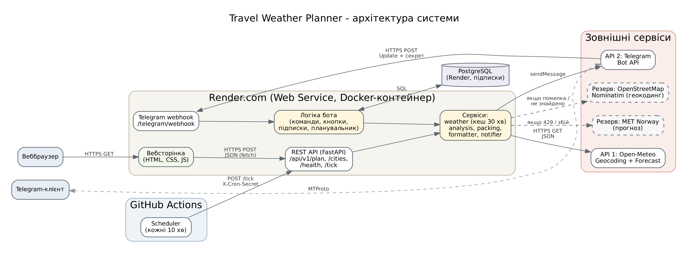
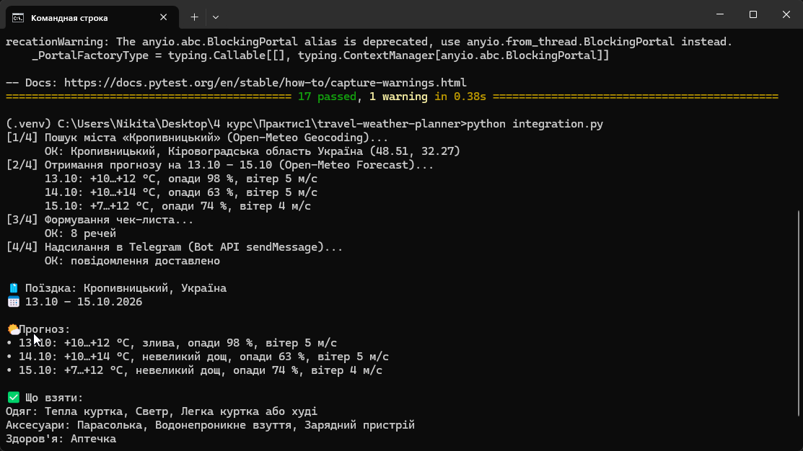
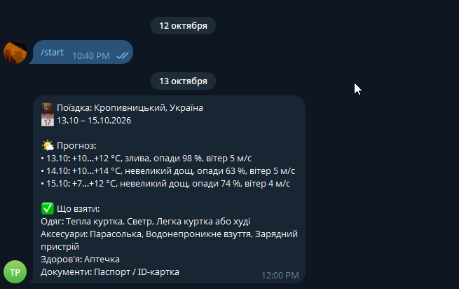
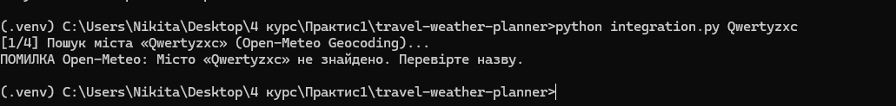
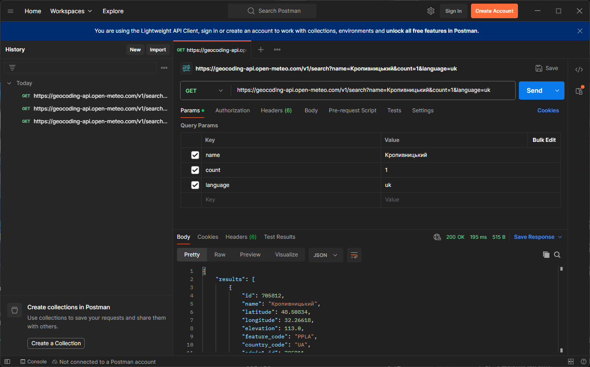
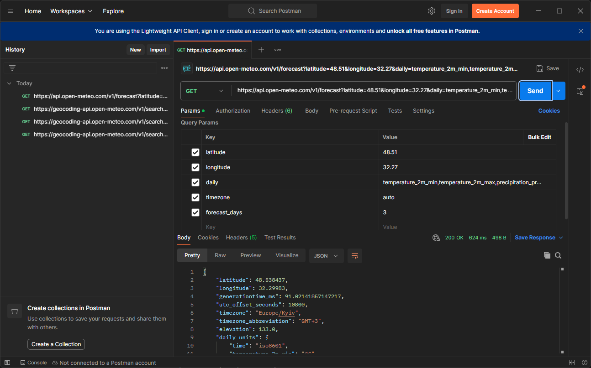
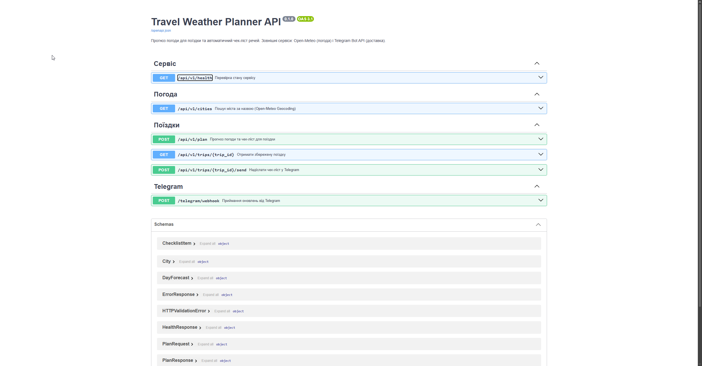

# 🧳 Travel Weather Planner — розумний помічник мандрівника

Користувач вводить місто та дати поїздки, система отримує прогноз погоди й автоматично формує чек-ліст речей (парасолька, сонцезахисні окуляри, теплий одяг тощо). Список показується на вебсторінці та надсилається в Telegram.

**Telegram-бот:** [@trip_weather_helper_bot](https://t.me/trip_weather_helper_bot)

## 📐 Архітектура системи



1. **Користувач** працює з системою через вебсторінку або Telegram-бота.
2. **Протоколи:** HTTPS REST (JSON) між фронтендом і бекендом та до зовнішніх API; Telegram надсилає оновлення на webhook бекенду (HTTPS POST).
3. **Бекенд** (FastAPI) запитує в **API 1 (Open-Meteo)** координати міста і прогноз погоди, формує чек-ліст і відправляє його через **API 2 (Telegram Bot API)**.
4. **Дані:** прогнози тимчасово кешуються в пам'яті (1 год), поїздки та `chat_id` користувачів зберігаються в SQLite.

Детальний аналіз предметної області: [`docs/day1-analysis.md`](docs/day1-analysis.md) · Схема API: [`docs/api.md`](docs/api.md)

## 🛠 Технологічний стек

- **Мова:** Python 3.12
- **Фреймворк:** FastAPI + Uvicorn, httpx (HTTP-клієнт)
- **База даних:** SQLite
- **Frontend:** HTML, CSS, JavaScript
- **Розгортання:** Docker, Render.com

**Інтегровані API:**

| API | Призначення | Ключ | Документація |
|---|---|---|---|
| Open-Meteo (Forecast + Geocoding) | Прогноз погоди до 16 днів, координати міста | Не потрібен | <https://open-meteo.com/en/docs> |
| Telegram Bot API | Надсилання чек-листа користувачу | Токен від @BotFather | <https://core.telegram.org/bots/api> |

## ✅ План реалізації

**Вівторок — інтеграція з API та безпека**
- [x] Токен Telegram-бота (@BotFather), секрети лише у `.env`
- [x] Перевірка запитів до Open-Meteo та Telegram у Postman
- [x] Скрипт інтеграції [`integration.py`](integration.py): Open-Meteo → чек-ліст → Telegram
- [x] Обробка помилок: мережа, тайм-аути, статус-коди, ліміти
- [x] Схема API застосунку: [`docs/api.md`](docs/api.md)

**Середа — бізнес-логіка та інтерфейс**
- [ ] REST-ендпоінти `/cities` і `/plan` на основі модулів інтеграції
- [ ] Мінімалістична вебсторінка (форма + результат)

**Четвер — інтеграція та контейнеризація**
- [ ] Telegram-бот: команди `/start`, `/plan` (webhook)
- [ ] `Dockerfile` та `docker-compose.yml`
- [ ] Розгортання на Render

**П'ятниця — тестування та звіт**
- [ ] Тестування API
- [ ] Оновлення README (інструкція запуску, посилання на демо)
- [ ] Звіт і презентація

## 📸 Результати

**Скрипт інтеграції** (`python integration.py`): Open-Meteo → чек-ліст → Telegram

<p>
  
  
</p>

**Обробка помилок** (неіснуюче місто — програма не падає):



**Тестування API в Postman** (200 OK):

<p>
  
  
</p>

**Документація API застосунку** (Swagger UI):



## 📁 Структура проєкту

```
travel-weather-planner/
├── app/
│   ├── main.py            # точка входу FastAPI
│   ├── config.py          # налаштування з .env
│   ├── schemas.py         # схеми даних API (Pydantic)
│   ├── api/
│   │   ├── routes.py      # REST-ендпоінти /api/v1/...
│   │   └── telegram.py    # webhook для Telegram
│   └── services/
│       ├── weather.py     # клієнт Open-Meteo
│       ├── packing.py     # формування чек-листа
│       ├── formatter.py   # текст повідомлення
│       └── notifier.py    # клієнт Telegram Bot API
├── static/                # фронтенд (HTML/CSS/JS)
├── tests/                 # тести (pytest)
├── docs/                  # схема архітектури, аналіз, опис API
├── integration.py         # скрипт інтеграції Open-Meteo → Telegram
├── requirements.txt
└── .env.example
```

## 🚀 Локальний запуск

Потрібен Python 3.10+.

```bash
python -m venv .venv
.venv\Scripts\activate            # Windows (на Linux/macOS: source .venv/bin/activate)
pip install -r requirements.txt
copy .env.example .env            # Windows (на Linux/macOS: cp .env.example .env)
```

У `.env` впишіть `TELEGRAM_BOT_TOKEN`, напишіть боту `/start` і дізнайтеся свій `TELEGRAM_CHAT_ID`:

```bash
python integration.py --find-chat-id
```

**Скрипт інтеграції** (прогноз → чек-ліст → повідомлення в Telegram):

```bash
python integration.py                                  # Кропивницький, сьогодні + 2 дні
python integration.py Львів 2026-10-15 2026-10-17
```

**Вебсервер:**

```bash
uvicorn app.main:app --reload
```

- Документація API (Swagger UI): <http://localhost:8000/docs>
- Перевірка стану: <http://localhost:8000/api/v1/health>
- Тести: `pytest`
